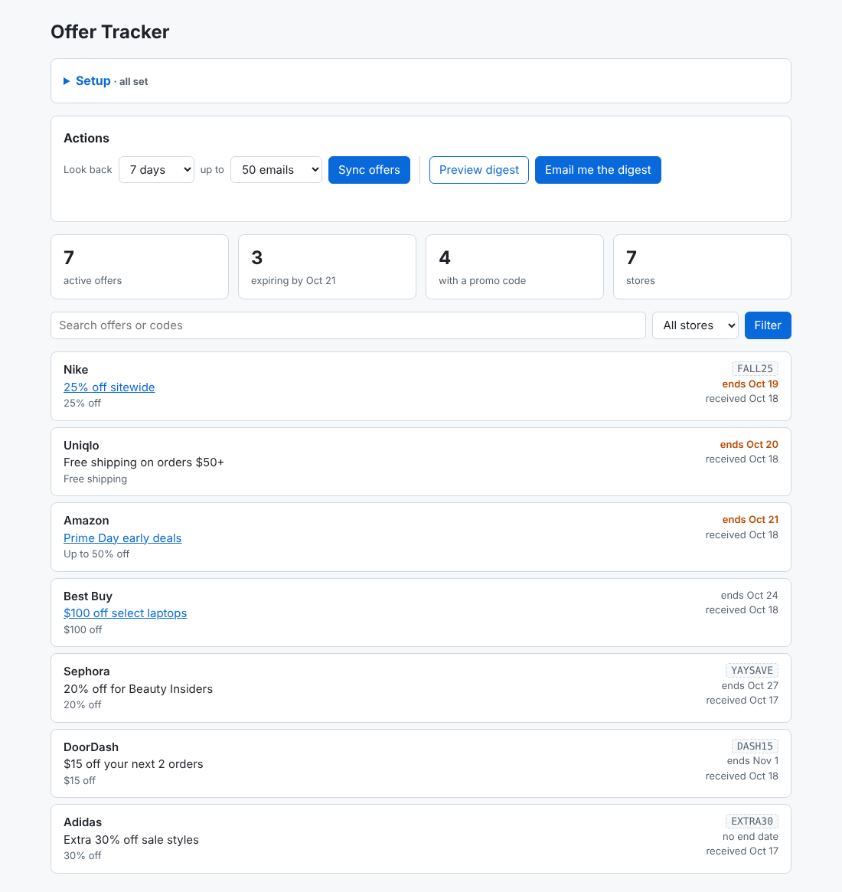
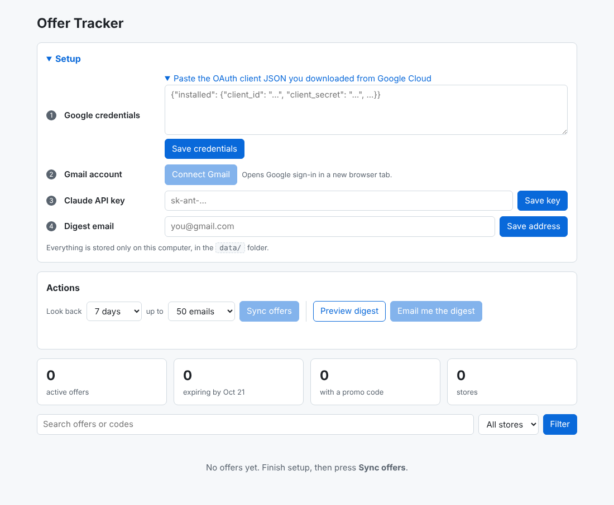

# Offer Tracker

Your inbox is full of promo codes and sales that expire before you remember them. Offer Tracker reads the promotions in your Gmail every morning, uses Claude to pull out the store, deal, code and expiry date, and emails you a digest of what's new and what's about to expire. A local dashboard lets you run every step with buttons and search everything that's still active.



## How it works

```
Gmail (Promotions) ──► pre-filter ──► Claude (structured output) ──► SQLite ──► daily digest email
                                                                        └──────► FastAPI dashboard
```

1. **Fetch.** `offer-tracker sync` searches Gmail (default `category:promotions newer_than:1d`) with a read-only scope.
2. **Filter.** A cheap regex skips emails with no sign of a deal, so newsletters and receipts never reach the API.
3. **Extract.** Claude returns JSON that matches a Pydantic schema: store, title, discount, code, expiry, and redeem link. Relative dates such as "ends Sunday" are resolved against the email's received date.
4. **Store.** Offers go into SQLite. The same store and code (or the same title, when there's no code) count as one offer, and a resend with a later end date extends the expiry.
5. **Digest.** `offer-tracker digest --send` emails you what's expiring in the next 3 days, today's new offers grouped by store, and what expired yesterday.
6. **Dashboard.** `offer-tracker serve` opens a local web app at `http://127.0.0.1:8000` with buttons for setup, syncing and the digest, a searchable list of active offers, and a JSON API at `/api/offers`.

## Setup

### 1. Install

```bash
python -m venv .venv && source .venv/bin/activate
pip install -e '.[dev]'
```

### 2. Create Google OAuth credentials

1. In the [Google Cloud console](https://console.cloud.google.com/), create a project and enable the **Gmail API**.
2. Set up the **OAuth consent screen** as an External app in Testing mode, and add your own address as a test user.
3. Create an **OAuth client ID** of type *Desktop app* and download the JSON.

The app asks for `gmail.readonly` (to read promotions) and `gmail.send` (to email you the digest). Nothing in your inbox is modified.

### 3. Run the dashboard

```bash
offer-tracker serve
```

Your browser opens the dashboard. Finish the **Setup** panel:

1. Paste the OAuth client JSON and click **Save credentials**.
2. Click **Connect Gmail** and approve access in the tab that opens.
3. Paste your [Claude API key](https://console.anthropic.com/) and click **Save key**.
4. Enter the address the digest should go to.

Then use **Sync offers** to pull in promotions, **Preview digest** to see the email, and **Email me the digest** to send it.



Credentials, the Gmail token and your settings are saved only in the local `data/` folder, which git ignores. Environment variables (`ANTHROPIC_API_KEY`, `DIGEST_TO`) take precedence over saved settings.

### Command line

Every button has a CLI equivalent, which the scheduled GitHub Action uses:

```bash
offer-tracker auth                                                 # connect Gmail (reads data/credentials.json)
offer-tracker sync --query "category:promotions newer_than:7d"   # pull and extract offers
offer-tracker digest --out digest.html                             # preview the digest
DIGEST_TO=you@gmail.com offer-tracker digest --send                # email it
```

## Configuration

| Variable | Default | Purpose |
|---|---|---|
| `OFFER_TRACKER_DATA_DIR` | `data` | Where the database, credentials and token live |
| `GMAIL_QUERY` | `category:promotions newer_than:1d` | Gmail search used by `sync` |
| `DIGEST_TO` | none | Address the digest is sent to |
| `CLAUDE_MODEL` | `claude-opus-5-5` | Model used for extraction |
| `EXPIRING_SOON_DAYS` | `3` | Window for the "Expiring soon" section |
| `DASHBOARD_URL` | none | Adds a "See all offers" link to the digest |

## Running it daily

`.github/workflows/daily.yml` runs `sync` and `digest --send` every morning on GitHub Actions. The SQLite database is carried between runs as a workflow artifact. Add these repository secrets:

- `ANTHROPIC_API_KEY`
- `GMAIL_TOKEN_JSON`, the contents of `data/token.json` after `offer-tracker auth`
- `DIGEST_TO`

Google expires refresh tokens for apps in Testing mode after 7 days. Publish the consent screen (it stays unverified, which is fine for personal use) so the token keeps working.

## Development

```bash
ruff check . && ruff format --check .
pytest
```

The tests use an in-memory database and a fake Claude client, so they need no credentials.

## License

MIT
